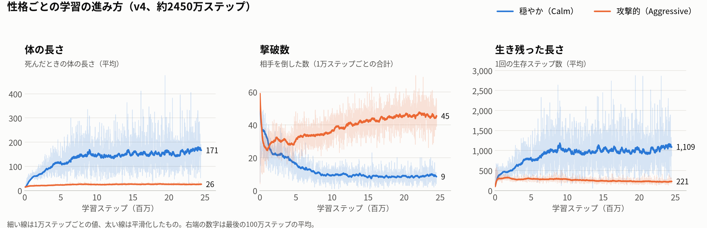

# Slither RL

スリザリオ風のヘビを、Unity ML-Agents の強化学習で育てるプロジェクトです。

## できること

- **スリザリオ風のゲーム**
  - 円形フィールドに色とりどりのエサ。食べるほど長く・太くなる
  - 常に前進し、なめらかに曲がる。ブーストで2倍速（代わりに体が減ってエサとして落ちる）
  - 他のヘビの体に頭が当たると死亡し、体がエサになってばらまかれる
  - 目つき。黒目は曲がる方向を先に見る
- **手で遊べる**：マウスの方向へ進む、左クリック / スペースでブースト
- **強化学習（PPO）**
  - 観測：頭のまわり16方向のレイで「エサ・ヘビの体・縁」までの近さ ＋ 長さなど（計53）
  - 行動：曲がる量（連続値）＋ ブーストする / しない
  - 学習中だけフィールドを16個複製して並列に学習
  - 画面なしのビルド版で、exeを複数同時に動かして高速に学習
- **録画用**：途中経過のモデル（.onnx）を10万ステップごとに保存。追従カメラ付き

## ブランチ

実験ごとにブランチを分けています。`git switch` で切り替えれば、その実験をそのまま再現・学習できます。

| ブランチ | 内容 | 学習コマンド（`Training` フォルダで実行） |
|---|---|---|
| `v1-single` | 1フィールドに1匹。エサ集めだけを学習（観測53） | `mlagents-learn slither_ppo.yaml --run-id=slither_v1 --env="Build\1. snake-RL.exe" --no-graphics --num-envs=4` |
| `v2-multi` | 1フィールドに6匹。他のヘビの体にぶつかると死亡（観測53） | `mlagents-learn slither_ppo.yaml --run-id=slither_v2 --initialize-from=slither_v1 --env="Build\1. snake-RL.exe" --no-graphics --num-envs=4` |
| `v4-personality`（= `main`） | 穏やか・攻撃的の2つの性格を同時に学習。近くの相手3匹の頭の位置・向き・大きさも観測（観測72）。豹変型は観戦時に2つのモデルを入れ替えて再現 | `mlagents-learn slither_personalities.yaml --run-id=slither_v4 --env="Build\1. snake-RL.exe" --no-graphics --num-envs=4` |

**切り替えの手順**

1. `git switch v2-multi` など（学習中は切り替えない）
2. Unity に戻ってコンパイルとシーンの読み込みを待つ
3. **Slither → Build Training Exe**（Ctrl + Alt + B）で exe を書き出し直す
4. 上の表のコマンドで学習

`Training/venv`・`Training/Build`・`Training/results` は git に入っていないので、ブランチを切り替えても共通のまま残ります。
そのため **切り替えたら必ず exe をビルドし直す**こと、**run-id はブランチごとに分ける**ことに注意。
学習済みモデルは各ブランチの `Assets/Models/` に入っています。

## 性格（v4-personality）

| 性格 | 報酬 | 学習結果（約2450万ステップ） |
|---|---|---|
| 穏やか（Calm） | エサ +0.5、他のヘビの体が5以内にいると毎ステップ −0.01 | 相手を避けて大きく育つ。体の長さ約170、死ぬまで約1100ステップ |
| 攻撃的（Aggressive） | エサ +0.2、相手を自分の体にぶつけて倒すと +20、相手の進路を体でふさぐと毎ステップ +0.01 | 小さいまま突っ込む特攻型。撃破数は穏やかの約5倍、死ぬまで約220ステップ |
| 豹変型（Switcher） | 学習はしない | 観戦時、ふだんは Calm Model、相手に近づかれる or ランダムでキレると Angry Model に入れ替わる（体が赤くなる） |

共通：死亡 −1、毎ステップ −0.001。学習済みモデルは `Assets/Models/v4/`。

報酬を変えるだけで、同じ観測・同じネットワークから、まったく違う戦い方が育ちました。穏やかは相手を避けて長く生き残り、体を大きくしていきます。攻撃的は体を伸ばさずに相手を倒しにいき、撃破数は穏やかの約5倍になります。



## フォルダ構成

```
Assets/
  Scripts/
    SlitherAgent.cs          ヘビ（エージェント）：移動・観測・行動・報酬・描画
    SlitherArena.cs          円形フィールドとエサの管理
    SlitherCamera.cs         頭を追いかけるカメラ（長くなるとズームアウト）
    SlitherTrainingAreas.cs  学習中だけフィールドを複製して並べる
  Scenes/SampleScene.unity   使用シーン
  Models/v4/                 学習済みモデル（.onnx）
  Editor/SlitherBuildMenu.cs 学習用 exe を書き出すメニュー（Slither → Build Training Exe）
Training/
  slither_ppo.yaml           学習設定（1種類）
  slither_personalities.yaml 学習設定（穏やか・攻撃的の2種類）
  README.md                  学習コマンドと TensorBoard の見方
  venv/  Build/  results/    ← 各PCで作る。git には入れない
docs/                        README の図
```

## 動作環境

| | バージョン |
|---|---|
| Unity | 6000.5.7f1（Universal 2D） |
| ML-Agents（Unity パッケージ） | 4.1.0 |
| Python | 3.10 |
| mlagents（Python） | 1.1.0 |
| PyTorch | 2.8.0 + CUDA 12.8 |
| GPU（開発環境） | RTX 5070 Ti |

> PyTorch は **2.8** を使う。2.9 以降は ONNX の書き出し方式が変わり、mlagents 1.1.0 だと `onnxscript` が無いというエラーで止まる。

## 別のPCでのセットアップ

### 1. 必要なものを入れる

- **Git**
- **Unity Hub** → Unity **6000.5.7f1** をインストール（モジュールに **Windows Build Support** を含める）
- **Python 3.10**（Python インストールマネージャーがあれば `py install 3.10`）

### 2. リポジトリを取ってくる

```powershell
cd C:\Users\<ユーザー名>\Unity
git clone git@github.com:8010yama/1.-slither-rl.git "1. snake-RL"
# SSH キーが無い場合
# git clone https://github.com/8010yama/1.-slither-rl.git "1. snake-RL"
```

### 3. Unity で開く

1. Unity Hub → **Add** → クローンしたフォルダを選ぶ
2. 開くと ML-Agents などのパッケージは自動で入る（初回は数分かかる）
3. `Assets/Scenes/SampleScene` を開く
4. **Edit → Project Settings → Editor → Enter Play Mode Settings** が「Reload Domain and Scene」になっているか確認

### 4. Python 環境を作る

```powershell
cd "C:\Users\<ユーザー名>\Unity\1. snake-RL\Training"
py -3.10 -m venv venv
.\venv\Scripts\Activate.ps1
python -m pip install --upgrade pip
pip install torch==2.8.0 --index-url https://download.pytorch.org/whl/cu128
pip install mlagents
python -c "import torch; print(torch.__version__, torch.cuda.is_available())"
```

`2.8.0+cu128 True` と出れば OK。

**つまずきやすいところ**

- `Activate.ps1` が実行できない → `Set-ExecutionPolicy -Scope CurrentUser RemoteSigned` を一度実行
- `import torch` で「アプリケーション制御ポリシーによってブロック」→ Windows の「スマート アプリ コントロール」が DLL を止めている。オフにする
- GPU が無い PC → `pip install torch==2.8.0` だけで CPU 版が入る。このモデルは小さいので CPU でも学習できる

### 5. 動作確認（手で遊ぶ）

1. Hierarchy の **Arena → Snake** を選ぶ
2. Behavior Parameters の **Behavior Type** を **Heuristic Only** にする
3. ▶ を押して、マウスで操作できれば OK
4. 確認したら **Default** に戻す

### 6. 学習用 exe を書き出す

1. **File → Build Profiles** → Windows のプロファイルが Active か確認（無ければ **Add Build Profile → Windows**）
2. メニューの **Slither → Build Training Exe**（Ctrl + Alt + B）を押す。シーンを保存して `Training\Build\` に書き出す
3. `Training\Build\1. snake-RL.exe` ができれば OK

スクリプトやシーンを変えたら、毎回書き出し直す。

### 7. 学習する

```powershell
cd "C:\Users\<ユーザー名>\Unity\1. snake-RL\Training"
.\venv\Scripts\Activate.ps1

# 画面なし・exe を4つ同時に動かす（一番速い）
mlagents-learn slither_ppo.yaml --run-id=slither_v1 --env="Build\1. snake-RL.exe" --no-graphics --num-envs=4

# 続きから：--resume ／ 最初からやり直す：--force
```

エディタで動きを見ながら学習する場合は、`--env` 以降を付けずに実行して、表示が出たら Unity で ▶。

### 8. 進み具合を見る

```powershell
tensorboard --logdir results
```

ブラウザで http://localhost:6006 を開き、`Environment/Cumulative Reward` と `Slither/Length` が右肩上がりなら順調。

### 9. 学習したモデルで動かす・録画する

1. `Training\results\slither_v1\Slither\` から使いたい `.onnx` を `Assets\` にコピー
2. Snake の Behavior Parameters → **Model** に割り当て、Behavior Type を **Inference Only**
3. `SlitherAgent` の **Max Episode Steps** を 0（途中でリセットされない）
4. Unity Recorder で 1080×1920 で書き出す

## ルールと報酬（現在）

- エサ1個：+0.5 ／ 毎ステップ：-0.001
- ブーストで体が1節減る：-0.5（落としたエサを拾い直すだけで得しないように）
- 300ステップエサを食べない：-0.5 でリセット
- 他のヘビに衝突：-1
- 縁は当たっても死なない（`Wall Kills` で変更可）。自分の体には当たらない
- 1エピソード最大 5000 ステップ（時間切れは失敗扱いにしない）

数値の多くは Inspector から変更できます。

## ライセンス

[MIT](LICENSE)
